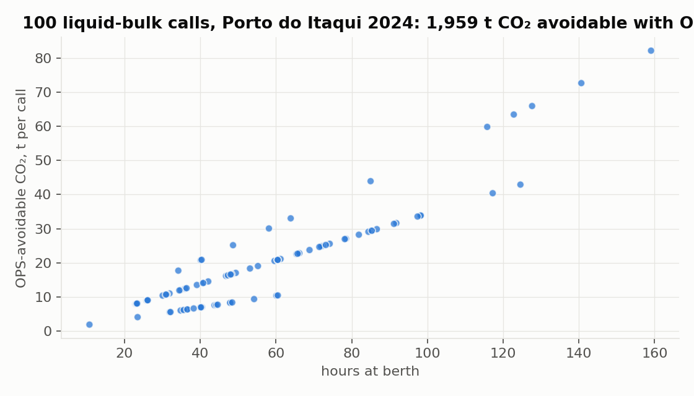
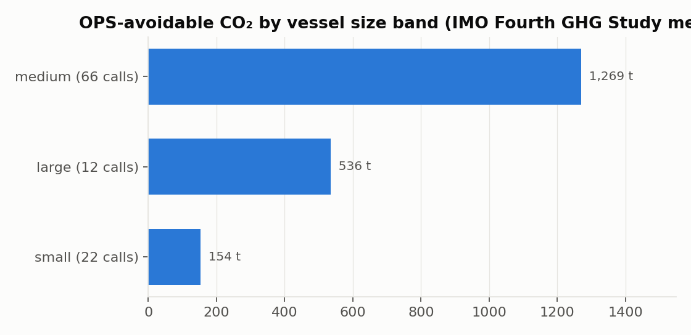

# maritime-co2

**Open, citable Python library to estimate the at-berth CO₂ that Onshore Power Supply (OPS) would avoid for liquid bulk (tanker) vessels, following the IMO Fourth Greenhouse Gas Study (2020) method**

[](https://doi.org/10.5281/zenodo.20708090)
[](LICENSE)
[](https://www.python.org)
[](tests/)
[](https://www.decarbport.com)

<p align="center">
  
</p>

## What this is

When a ship connects to shore power at berth, it shuts down its **auxiliary engines**. The CO₂ that OPS avoids is therefore the auxiliary-engine emission during the stay. `maritime-co2` computes it call by call from operational inputs (deadweight, hours at berth) with transparent, standard parameters and no proprietary calibration. The same method powers the interactive calculator at [decarbport.com](https://www.decarbport.com).

**Key modelling choice.** OPS replaces the auxiliary-engine (hotelling) load only. **Boilers are excluded**: at a liquid-bulk terminal the boiler keeps running on fuel for cargo heating and is not supplied by shore power. This follows standard OPS accounting practice.

## Method

```
energy_kWh  = aux_power_kW × load_factor × berth_hours
fuel_tonnes = energy_kWh × SFOC (g/kWh) / 1e6
CO2_avoided = fuel_tonnes × Cf

# optional, net of the electricity that replaces it
grid_CO2    = energy_kWh / 1000 × grid_factor (t CO₂ per MWh)
net_avoided = CO2_avoided − grid_CO2
```

| Parameter | Default | Source |
|---|---|---|
| Carbon factor Cf | MDO/MGO 3.206, HFO 3.114 t CO₂ per t fuel | IMO Fourth GHG Study 2020 |
| SFOC, auxiliary engine | MDO/MGO 185 g/kWh, HFO 195 g/kWh | IMO Fourth GHG Study 2020, Table 19 |
| Auxiliary power at berth | By ship type and size band (table below) | IMO Fourth GHG Study 2020, Table 17 |
| Load factor | 1.0 (Table 17 already gives the power output at berth) | |
| Grid emission factor | None; supplied by the user | e.g. MCTI (Brazil), EEA (EU) |

Auxiliary engine power output at berth (kW):

| Oil tanker (dwt) | kW | Chemical tanker (dwt) | kW | Liquefied gas tanker (cbm) | kW |
|---|---|---|---|---|---|
| 0–4,999 | 250 | 0–4,999 | 110 | 0–49,999 | 240 |
| 5,000–9,999 | 375 | 5,000–9,999 | 330 | 50,000–99,999 | 1,700 |
| 10,000–19,999 | 690 | 10,000–19,999 | 330 | 100,000–199,999 | 2,500 |
| 20,000–59,999 | 720 | 20,000–39,999 | 790 | 200,000+ | 6,750 |
| 60,000–79,999 | 620 | 40,000+ | 790 | | |
| 80,000–119,999 | 800 | | | | |
| 120,000+ | 2,500 | | | | |

These are fleet reference values from the IMO study, not measurements of a specific vessel, and they are not calibrated to any private dataset. Replace them with ship data when you have it.

**Ship type matters.** Petroleum products (diesel, petrol) travel on both oil tankers and chemical/products tankers, which have different auxiliary power, so cargo alone does not settle the type. The default is `oil_tanker`; pass the registered type per call with `ship_type_col` when you have it. `suggest_ship_type(cargo)` gives a first guess from the cargo description (LPG to gas tanker; caustic soda, ethanol and vegetable oils to chemical tanker). For gas tankers the size is cargo capacity in cubic metres, not deadweight.

## Gallery

| Call by call | By vessel size band |
|---|---|
|  |  |

Figures use the bundled sample of 100 real liquid-bulk calls at Porto do Itaqui in 2024 (about 10% of the port's annual liquid-bulk calls): 2,294 t of OPS-avoidable CO₂ with the default parameters (all calls treated as oil tankers).

## Installation and quick start

```bash
git clone https://github.com/darlianecunha/maritimeco2
cd maritimeco2
pip install -e .
```

```python
import pandas as pd
from maritime_co2 import estimate_ops_savings

calls = pd.read_csv("data/sample/itaqui_liquid_bulk_2024_sample.csv")
result = estimate_ops_savings(calls)
print(result[["call_id", "dwt", "size_band", "berth_hours", "co2_avoided_tonnes"]].head())
print("Total OPS-avoidable CO2:", round(result["co2_avoided_tonnes"].sum(), 1), "t")  # 2294.0
```

By ship type, and net of the grid emissions of the shore power:

```python
from maritime_co2 import suggest_ship_type

calls["ship_type"] = calls["product"].map(suggest_ship_type)
result = estimate_ops_savings(calls, ship_type_col="ship_type", grid_factor=0.0545)  # Brazil, 2024 average (MCTI)
print(result[["co2_avoided_tonnes", "grid_co2_tonnes", "net_avoided_tonnes"]].sum().round(1))
# co2_avoided_tonnes 2253.8 · grid_co2_tonnes 207.1 · net_avoided_tonnes 2046.7
```

The sample has no cargo capacity, so gas tankers are sized here by deadweight; every LPG carrier in it is below 9,000 dwt and falls in the first capacity band (240 kW).

Tests:

```bash
pip install pytest
pytest
```

## Repository map

| Path | Content |
|---|---|
| `maritime_co2/core.py` | `auxiliary_emissions()` and `estimate_ops_savings()` |
| `maritime_co2/factors.py` | Carbon factors, SFOC and Table 17 power by ship type (all documented) |
| `data/sample/` | 100 real port calls, Porto do Itaqui 2024 (operational inputs only) |
| `notebooks/01_quickstart.ipynb` | Worked example |
| `tests/` | pytest suite |
| `docs/gallery/` | Figures used in this README |

## Roadmap

- [x] OPS-avoidable at-berth CO₂ for liquid bulk (auxiliary only)
- [x] IMO Table 17 power by ship type (oil, chemical, liquefied gas) and net avoided emissions with a grid factor (0.2.0)
- [ ] Sensitivity analysis over auxiliary power and load factor
- [ ] Cost and payback module for OPS infrastructure
- [ ] Extend to other vessel types

## Related work

- [decarbport.com](https://www.decarbport.com): interactive CO₂ calculator for liquid-bulk vessels (React/TypeScript) built on this method
- [Brazil_Vessel_Call_Intelligence](https://github.com/darlianecunha/Brazil_Vessel_Call_Intelligence): at-berth emissions and OPS potential for 30,972 port calls
- The activity-based approach applied to Porto do Itaqui (2022–2024) received the Best Paper award at the 3rd National Congress Integra Portos, Brazil (2025)

## Changelog

**0.2.0.** Defaults now come from the IMO Fourth GHG Study 2020 itself: auxiliary power output at berth from Table 17 by ship type and size band (oil, chemical and liquefied gas tankers), SFOC from Table 19 (185 g/kWh MDO/MGO, 195 g/kWh HFO) and no load factor. New: `ship_type` / `ship_type_col`, `aux_power_at_berth()`, `size_band_label()`, `suggest_ship_type()`, and `grid_factor` for net avoided emissions. Results differ from 0.1.0 (sample total 2,294 t against 1,959 t). The 0.1.0 illustrative profile (500 / 1,000 / 1,500 kW at load factor 0.5, SFOC 215) still runs with `estimate_ops_savings(calls, profile=AUX_PROFILE, sfoc=215)`.

**0.1.0.** First release, with an illustrative three-band power profile.

## How to cite

Metadata in [`CITATION.cff`](CITATION.cff).

> Cunha, D. R., Oliveira, C. B. M., & Santos, V. R. P. (2026). *maritime-co2: OPS-avoidable at-berth CO₂ for liquid bulk (tanker) vessels* (Version 0.2.0) [Software]. Zenodo. https://doi.org/10.5281/zenodo.20708090

## Author and licence

**Darliane Ribeiro Cunha, PhD**. [ribeirocunha.com](https://ribeirocunha.com) · [ORCID 0000-0003-2548-1237](https://orcid.org/0000-0003-2548-1237)

[MIT](LICENSE).
